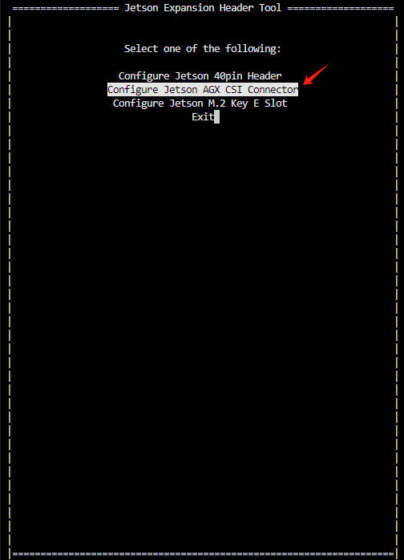
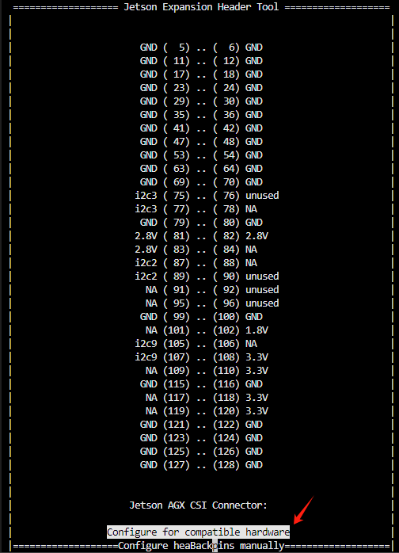
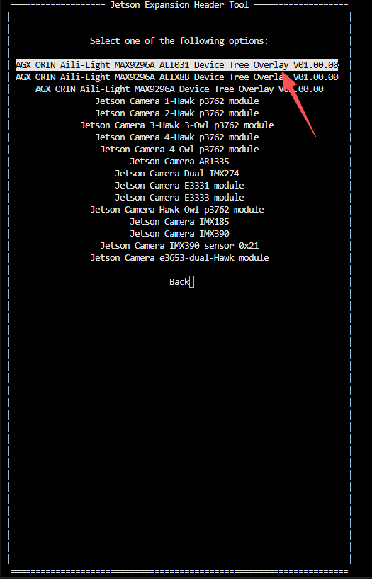
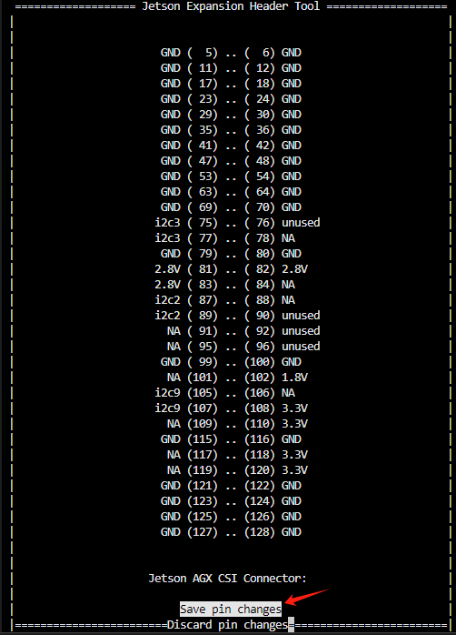
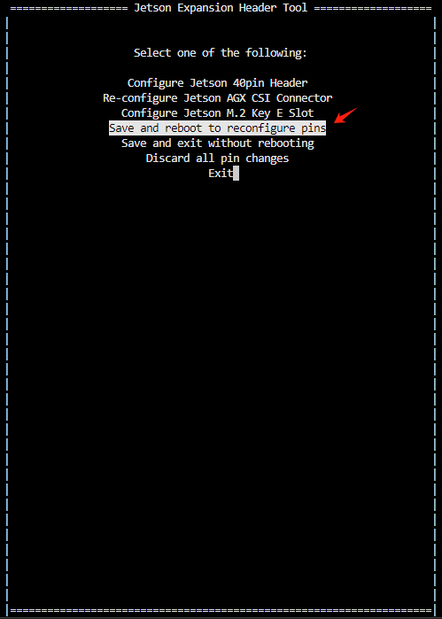

# 艾利光相机通用驱动使用说明


## 1. 适配平台

此驱动只适配于NVIDIA官方的主机`agx orin develop kit 64g`的硬件！


适配版本jetpak版本：6.2

对应的jeston Linux 版本：r36.4.3

上述软件版本可以使用指令`jtop`中的`7INFO`页面查看：


如果系统不是r36.4.3，可以参考官方的烧录指导，刷系统到r36.4.3：

​	https://docs.nvidia.com/jetson/archives/r36.4.3/DeveloperGuide/IN/QuickStart.html#preparing-a-jetson-developer-kit-for-use


## 2. pinmux 刷机说明

当前硬件使用orin的相机接口的引脚作为帧同步触发，所以需要修改pinmux，

参考官方指导：[Pinmux Changes#](https://docs.nvidia.com/jetson/archives/r36.4.3/DeveloperGuide/HR/JetsonModuleAdaptationAndBringUp/JetsonAgxOrinSeries.html#pinmux-changes)

把我们提供的 `bsp_out/pinmux/Linux_for_Tegra`下我文件替换刷机环境中对应的文件，然后重新刷机即可。

如果系统已经刷好，不想重新刷机，只想刷MB1的BCT的pinmux，则刷机使用如下命令：

``` bash
# 如果烧录到emmc
sudo ./flash.sh  -k A_MB1_BCT  jetson-agx-orin-devkit mmcblk0p1
# 如果烧录到外部NVMe硬盘
sudo ./flash.sh  -k A_MB1_BCT  jetson-agx-orin-devkit external

# -k 指定分区，A_MB1_BCT表示烧录MB1的BCT分区
# jetson-agx-orin-devkit 表示对应板卡
# mmcblk0p1 或者 external 表示烧录的存储器：
#     * mmcblk0p1 表示emmc，
#     * external 表示外部NVMe硬盘
```


### 验证pinmux是否成功

首先需要安装软件busybox，安装指令：

``` bash
sudo apt-get install busybox
```

然后读取几个关键寄存器，查看是否符合预期

``` bash
# 读取一个相机的复位引脚的pinmux寄存器，如果返回0x00000001，表示pinmux生效
sudo busybox devmem 0x0c302028

# 读取一个相机的电源引脚的pinmux寄存器，如果返回0x00001001，表示pinmux生效
sudo busybox devmem 0x0c302048

# 读取1CH的触发输出引脚的pinmux寄存器，如果返回0x00000003，表示pinmux生效
sudo busybox devmem 0x02448040

# 读取触发输入引脚的pinmux寄存器，如果返回0x00000050，表示pinmux生效
sudo busybox devmem 0x02448038

```


## 3. 编译说明

首先参考官方的内核搭建方法搭建内核编译环境，并进行编译：[Kernel Customization#](https://docs.nvidia.com/jetson/archives/r36.4.3/DeveloperGuide/SD/Kernel/KernelCustomization.html#kernel-customization)

然后把`kernel_src`下的文件拷贝到源码目录下重新编译即可。编译可以输出：

设备树：

* `tegra234-p3737-0000-camera-aili-light-max9296-ali031-overlay.dtbo`

* `tegra234-p3737-0000-camera-aili-light-max9296-alix8b-overlay.dtbo`

驱动：

* `alg-max9296-ali031.ko`
* `alg-max9296-alix8b.ko`
* `trigger.ko`

一些源码关键说明

* 设备树中，`deser-config`表示进行GMSL串行解串器配置下发，因为这里解串器是max9296，所以2个相机通道下发一次GMSL配置即可

* 设备树中,`config_index` 表示配置表索引，在源码中放了多份配置表，比如031的驱动源码中：

  * 1 表示的是解串器接1个master固件的031相机
  * 2 表示的是解串器接2个master固件的031相机
  * 3 表示的是解串器接1个slave固件的031相机
  * 4 表示的是解串器接2个slave固件的031相机

  所以这里需要根据实际接的相机类型和数量进行更改

* 设备树中`aili_trigger`表示的是触发器设备节点，用来帧同步触发。可以通过修改`period-ns`修改触发信号周期，`pluse-width-ns`修改触发信号脉宽


## 4. 设备树加载

设备树只加载1次就好,后续重启主机不需要加载，设备树加载可以参考官方指导：

[Configuring the CSI Connector](https://docs.nvidia.com/jetson/archives/r36.4.3/DeveloperGuide/HR/ConfiguringTheJetsonExpansionHeaders.html#configuring-the-csi-connector)

如下以031为例说明（X8B类似）：


1. 首先把源码编译出的设备树拷贝到orin主机中
2. 运行再orin端运行指令`sudo cp tegra234-p3737-0000-camera-aili-light-max9296-ali031-overlay.dtbo /boot/`，首先把设备树插件放入到`/boot`文件夹下，
3. 运行指令：`sudo /opt/nvidia/jetson-io/jetson-io.py` 打开软件jetson-io
4. 选择`Configure Jetson AGX CSI Connector`



4. 选择`Configure for compatible hardware`



5. 选择`AGX ORIN Aili-Light MAX9296A ALI031 Device Tree Overlay V01.00.00.00`



6. 选择`Save pin changes`



7. 选择`Save and reboot to reconfigure pins`



8. 等待设备重启，重启之后，可以通过如下指令查看设备树加载是否成功,成功的话，会有如下输出

``` sh
$ ls /proc/device-tree/bus@0/i2c@3180000/tca9546@70/i2c@0/

gmslcomm_a@4 gmslcomm_b@5 ...
```


## 5. 相机驱动加载

驱动在系统开机之后，首先把相机正常接好，然后把源码编译的驱动拷贝到ORIN。然后在ORIN端，手动加载对应相机驱动，这里以031为例：

`sudo insmod driver/alg-max9296-ali031.ko`

注意：加载驱动指令执行后，需要等待3-5秒，等待所有video设备全部加载成功！

可以使用如下指令查看是否成功，成功会有如下输出

``` sh
$ ls /dev/vid*

/dev/video0  /dev/video1  /dev/video2  /dev/video3  /dev/video4  /dev/video5  /dev/video6  /dev/video7
```


## 6. 触发器驱动加载

驱动在系统开机之后，需要手动加载`trigger.ko`

`sudo insmod driver/trigger.ko`

可以使用如下指令查看是否成功，成功会有如下输出

``` sh
$ sudo dmesg | grep  aili-trigger
[  833.616227] aili-trigger bus@0:aili_trigger: started: 8 GPIOs, period=33333333 ns, pulse=1000000 ns
```


## 7. 预览

驱动加载完成之后，可以使用gstreamer去预览，比如显示031图像可以使用如下指令：

``` sh
# 031分辨率 1920x1536 /dev/video0是设备节点
$ gst-launch-1.0 v4l2src device=/dev/video0 ! 'video/x-raw,format=UYVY,width=1920,height=1536' ! videoconvert ! fpsdisplaysink video-sink=xvimagesink sync=false &
```

比如显示X8B图像可以使用如下指令：

``` sh
# X8B分辨率 3840x2160 /dev/video0是设备节点
$ gst-launch-1.0 v4l2src device=/dev/video0 ! 'video/x-raw,format=UYVY,width=3840,height=2160' ! videoconvert ! fpsdisplaysink video-sink=xvimagesink sync=false &
```